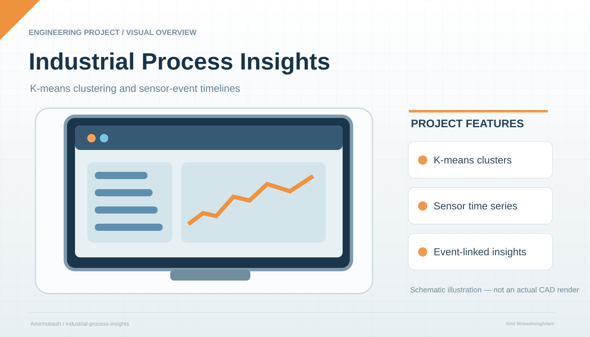

# Industrial Process Insights


<p align="center"></p>

<sub>Illustrative project schematic; not an actual CAD export, hardware photograph, or independently tested result.</sub>


**Industrielle Prozessanalyse mit K-Means-Clustering und ereignisbasierter Zeitreihe.**

Dieses Projekt verbindet die Ideen und Quellprojekte von Microsofts **Pulse Chart** und **K-Means-Clustering** in einem gemeinsamen Analyseablauf. Messungen erhalten eine Clusterzuordnung; diese Zuordnung wird mit Sensorverlauf und Ereignissen über dieselbe Messungs-ID verknüpft. Ein deutschsprachiges Offline-Dashboard macht den Ablauf direkt nachvollziehbar.

> **Projektstatus:** Ausführbarer Python-Analyseablauf und HTML-Dashboard mit synthetischen Daten. Die beiden historischen Power-BI-Visuals liegen als getrennte Quellmodule bei. Es handelt sich nicht um ein neu kompiliertes gemeinsames `.pbiviz` oder einen fertigen `.pbix`-Bericht. Ein moderner Power-BI-Build der Altmodule wurde nicht validiert.

## Sofort ansehen

ZIP entpacken und **`output/dashboard.html`** im Desktop-Browser öffnen. Die Demo ist bereits berechnet und benötigt weder Installation noch Internet. Anlage und Messgröße auswählen; ein Cluster hebt die passenden Punkte in beiden Diagrammen hervor. Ein Punkt zeigt dieselbe Messung mit ihren Sensorwerten und Ereignissen an.

## Analyse selbst ausführen

Voraussetzung: **Python 3.10 oder neuer**, ausschließlich Standardbibliothek; keine zusätzlichen Pakete.

Im Hauptordner:

```sh
python src/pipeline.py
python -m unittest discover -s tests -v
```

Unter Windows gegebenenfalls `py` statt `python` verwenden. Für eigene Daten:

```sh
python src/pipeline.py --input data/meine_messungen.csv --clusters 3 --output output
```

## Datenvertrag

CSV: UTF-8, Komma als Trennzeichen, Punkt als Dezimalzeichen. Pflichtspalten:

| Spalte | Bedeutung | Beispiel |
|---|---|---|
| Zeitstempel | ISO-8601 mit Zeitzone; je Anlage eindeutig | `2026-01-15T08:00:00+01:00` |
| Anlage | Anlagenkennung | `Pumpe-01` |
| Temperatur_C | Endlicher numerischer Messwert | `65.2` |
| Druck_bar | Endlicher numerischer Messwert | `4.1` |
| Vibration_mm_s | Endlicher numerischer Messwert | `1.8` |
| Ereignis | Optionaler Text; Spalte ist erforderlich | `Ventilprüfung` |

Die Demo enthält **360 synthetische Messungen von zwei Pumpen**. Sie ist kein Datensatz einer realen Anlage. Pro Anlage wird zeitlich sortiert. Alle Anlagen werden gemeinsam mit einem Modell geclustert; nur bei vergleichbaren Sensoren und Betriebsbedingungen ist das sinnvoll.

## Was wird kombiniert?

1. Temperatur, Druck und Vibration werden per Z-Score standardisiert; konstante Merkmale erhalten den Skalierungsfaktor 1.
2. K-Means++-Initialisierung und zehn deterministische Neustarts bilden Ähnlichkeitsgruppen; das Ergebnis mit kleinster quadratischer Distanz wird gewählt. Maximal 200 Iterationen pro Neustart. Iterationsanzahl und Zentren stehen in `modell.json`; Erreichen des Limits ist kein Konvergenznachweis.
3. Cluster werden nach aufsteigender Zentrumstemperatur nummeriert. Eine Nummer ist keine fachliche Bewertung und bleibt bei neuem Training nicht zwingend gleich.
4. Clusterwechsel werden **getrennt je Anlage** als Ereignisse ergänzt. Vorhandene Ereignistexte bleiben erhalten.
5. Zeitreihe, Streudiagramm und Ereignisprotokoll nutzen dieselben Messungen, Cluster und Anlagenfilter.

Die neue Python-Implementierung ist unabhängig geschrieben; sie portiert nicht alle Funktionen des ursprünglichen R-Visuals. PCA, automatische Wahl von k und Konfidenzellipsen sind nicht Bestandteil des neuen Ablaufs. K-Means liefert weder Fehlerwahrscheinlichkeiten noch automatisch eine vorausschauende Wartung.

## Ergebnisse

| Datei | Verwendung |
|---|---|
| `output/dashboard.html` | Eigenständiges deutsches Dashboard mit eingebetteten Daten |
| `output/prozessdaten_cluster.csv` | Gemeinsame Datenbasis für Power BI |
| `output/modell.json` | Skalierung, Clusterzentren, Seed und Gütemaß |
| `powerbi/Prozessdaten.pq` | Power-Query-Importvorlage |
| `powerbi/Kennzahlen.dax` | Beispielkennzahlen |
| `visuals/pulsechart/` | Vollständiger mitgelieferter Pulse-Chart-Quellstand |
| `visuals/kmeans/` | Vollständiger mitgelieferter K-Means-Quellstand inklusive R und Beispiel-PBIX |

## Power BI

Die genaue Feldzuordnung und Einrichtung stehen in [docs/POWER_BI.md](docs/POWER_BI.md). Für den gemeinsamen Bericht ist die **vorberechnete Cluster-Spalte** maßgeblich. Eine erneute Berechnung im alten R-Visual kann andere Gruppen erzeugen.

## Herkunft und Sprache

Neue Dokumentation, Dashboard und Bezeichnungen der Visual-Metadaten sind deutsch. Technische Identifikatoren, historische Kommentare, upstream README-Kopien und Tests der Originalprojekte bleiben teilweise englisch, damit Schnittstellen und Herkunft nachvollziehbar bleiben. Pulse Chart bringt außerdem seine ursprünglichen mehrsprachigen Ressourcen mit; Deutsch ist dort vorhanden.

[docs/HERKUNFT.md](docs/HERKUNFT.md) dokumentiert Herkunft, Lizenzen und Änderungen. Microsoft bleibt als ursprünglicher Autor der mitgelieferten Visuals ausgewiesen.
